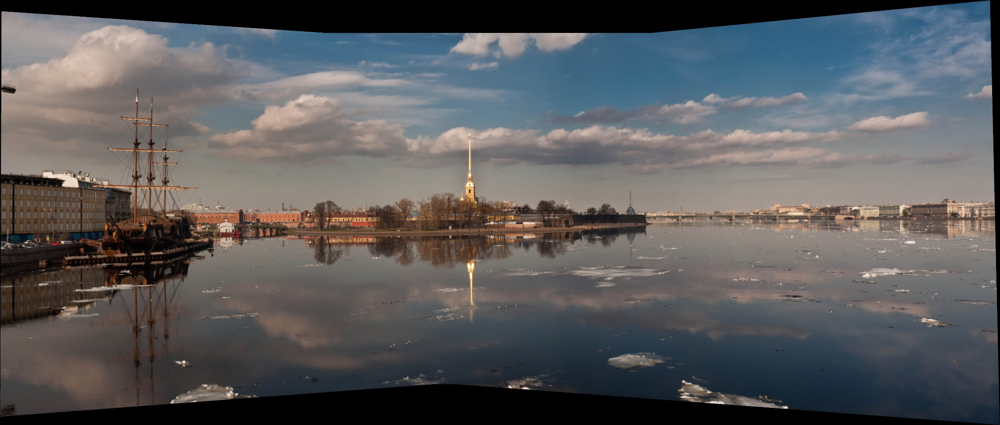

# 实验三：图像拼接

基于参考代码实现 **SIFT → FLANN → Lowe 比率筛选 → RANSAC 单应矩阵 → 透视变换 → 图像融合**。以 [report.md](report.md) 为实验说明依据，全部代码集中在唯一的 [image_stitching.ipynb](notebooks/image_stitching.ipynb) 中，已在 **Conda 环境**中完整运行。

## 直接查看

- **[实验 Notebook（ipynb，含全部代码和运行输出）](notebooks/image_stitching.ipynb)**：27 个单元格，其中 13 个代码单元格，包含核心算法、图片下载、完整实验、可选工具和测试，逐步展示原图、特征、匹配、画布与拼接结果。
- **[详细实验报告（Markdown）](report.md)**：实验目的、数据来源、算法原理、三场景结果、30 组参数对比、正确性检查和结论。
- [原图与来源](data/SOURCES.md)、[实测指标](results/metrics.csv)、[完整参数扫描](results/parameter_sweep.csv)。

Notebook 主线与报告对应：数据检查、算法步骤、三场景实验、参数比较、正确性测试和结论。人工亮度变化、三图拼接及辅助工具保留在附录 A、B、C；仓库不包含独立 `.py` 文件。




## 文件结构

```text
requirements.txt                   实验核心依赖的固定版本
notebooks/image_stitching.ipynb    全部实验代码、工具、测试及运行输出
report.md                          详细 Markdown 报告
data/                              7 张网上获取的原始照片及来源
results/                           匹配图、拼接图、CSV 和 JSON
```

## 已验证结果

Notebook 最终在已有 Conda `cvex` 的 Python 3.10.21 中执行，使用 OpenCV 4.11.0、NumPy 2.2.6、Matplotlib 3.10.3。
全部代码已合并到 Notebook 的对应单元格，在 Conda 内核中按顺序运行全部单元格即可。

| 场景 | 候选匹配 | RANSAC 内点 | 内点率 | 内点 RMSE / 像素 |
| --- | ---: | ---: | ---: | ---: |
| 船坞 | 748 | 670 | 89.57% | 0.506 |
| 地图 | 626 | 599 | 95.69% | 1.486 |
| 报纸 | 1270 | 1142 | 89.92% | 0.370 |

默认 Lowe 比率 0.70、RANSAC 阈值 5 像素，处理图像最长边不超过 1200 像素；三图船坞结果为 2277 × 968。
4 项行为测试通过。完整环境信息见 [environment.json](results/environment.json)。
