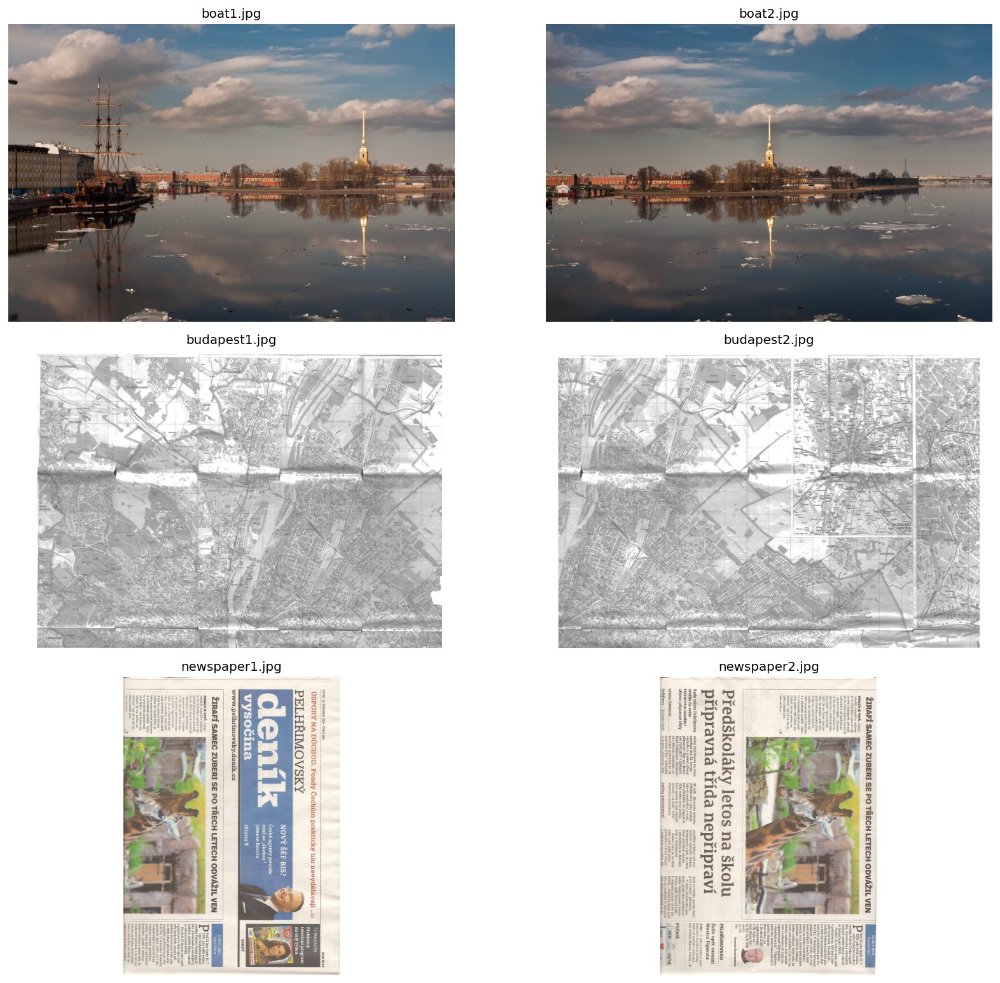
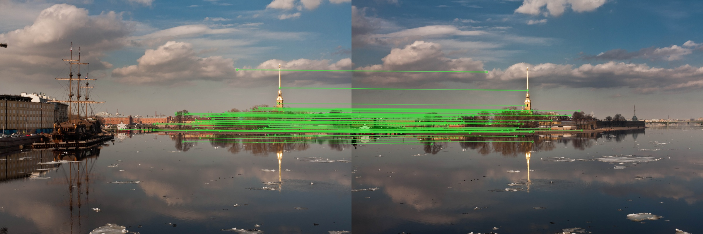
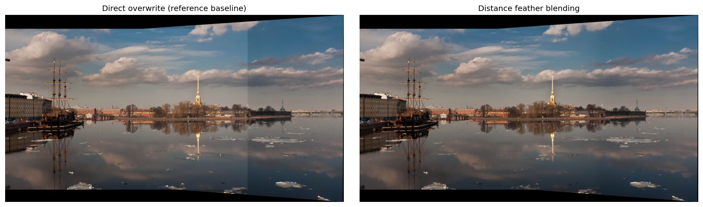
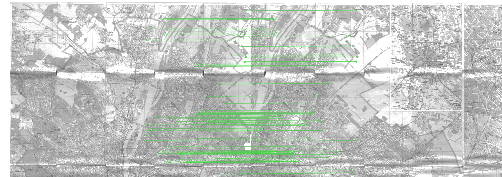
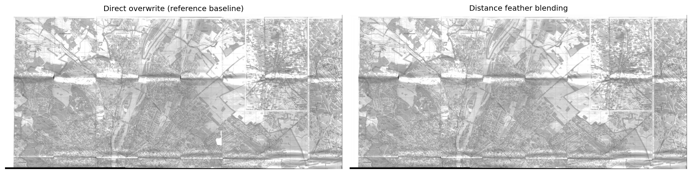
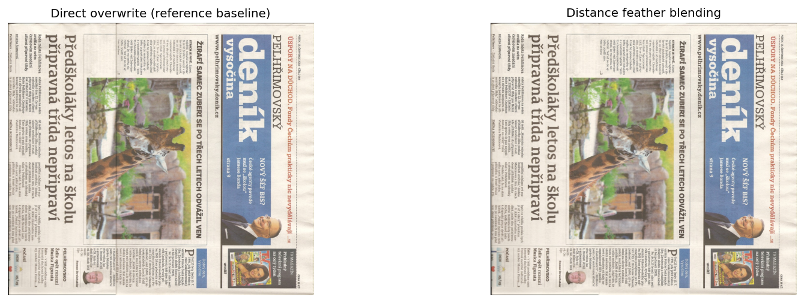
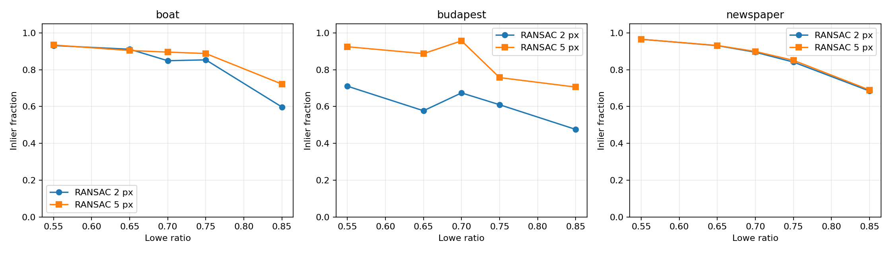
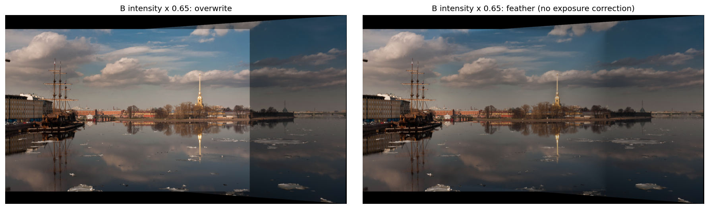

# 实验三：基于 SIFT、FLANN 与 RANSAC 的图像拼接实验报告

**实验主题：** 局部特征匹配、单应性估计、透视变换与图像融合  
**实验日期：** 2026 年 10 月 22 日  
**实现形式：** Python / OpenCV / Conda / Jupyter Notebook  
**对应文件：** [image_stitching.ipynb](notebooks/image_stitching.ipynb)

## 摘要

本实验以课程提供的《实验三参考代码.pdf》为流程依据，实现了从两张具有重叠区域的照片生成拼接图像的完整过程。程序首先读取图像并转换为灰度图，提取 SIFT 关键点及描述符；随后通过 FLANN 搜索近邻，使用 Lowe 比率测试过滤歧义匹配，再利用 RANSAC 估计将图像 B 映射到图像 A 的单应矩阵。完成坐标变换后，程序根据两幅图像的联合角点计算输出画布，并比较直接覆盖和基于距离变换的渐变融合。

实验从 OpenCV 官方测试数据仓库获取 7 张照片，组成船坞、地图和报纸三个双图场景，并用第三张船坞照片进行多图扩展。默认参数下，三个双图场景分别得到 670、599、1142 个 RANSAC 内点，对应内点率为 89.57%、95.69%、89.92%，内点重投影 RMSE 分别约为 0.506、1.486、0.370 像素。进一步执行 30 组参数组合，并固定几何变换开展人工亮度变化对照。结果表明，局部特征与鲁棒几何估计能够在这些输入上建立有效配准，距离渐变融合可以减轻可见亮度接缝，但仍受到纸张非平面、视差、曝光变化和投影形变的限制。

全部指标由最终 Conda 环境中的 Notebook 实际运行生成，原始 CSV、JSON、匹配图和拼接图均保存在 `results/`。报告不将拟合内点残差等同于独立测试精度，也不将渐变融合描述为曝光校正或鬼影消除。

**关键词：** 图像拼接；SIFT；FLANN；RANSAC；单应矩阵；渐变融合

## 1. 实验目的与任务

### 1.1 实验目的

本实验的第一项目的是理解图像拼接中的数据关联问题：两张照片虽然描述同一场景的一部分，但像素坐标、视角和亮度可能不同，不能简单依靠左右排列得到完整图像。需要先寻找“同一场景位置在两张图中的对应点”，再根据对应关系建立几何模型。

第二项目的是掌握局部特征描述和特征匹配的基本方法。特征点不仅是图上的一个坐标，还包含尺度、方向等信息；描述符则将邻域结构变为便于比较的向量。通过观察关键点和匹配连线，可以把抽象算法与图像中的建筑轮廓、船体、道路和文字等结构联系起来。

第三项目的是理解鲁棒估计的必要性。描述符相似并不代表两个点一定对应同一真实位置，重复纹理会产生误匹配。实验需要利用 RANSAC，从含有错误对应的候选集合中估计较可靠的单应矩阵，并区分候选匹配、几何内点和最终视觉效果。

第四项目的是完成可复现的实验记录。除了运行成功，还应记录输入来源、预处理尺寸、参数、环境、结果及失败条件，使其他人能够从 Notebook 中重新得到实验过程，而不是只看到一张缺少解释的最终图片。

### 1.2 任务内容

| 任务 | 本实验完成情况 |
| --- | --- |
| 阅读参考流程 | 保留 SIFT、FLANN、0.70 比率、5 像素 RANSAC 及 B→A 坐标方向 |
| 寻找实验图片 | 从官方测试数据中获取 7 张实际照片，附固定提交和 SHA256 |
| 完成双图拼接 | 分别处理船坞、地图和报纸三组输入 |
| 可视化中间过程 | 输出原图、关键点、匹配点、掩膜和拼接对照 |
| 分析融合方法 | 对比参考代码的直接覆盖与距离渐变融合 |
| 设计参数实验 | 5 个 Lowe 比率 × 2 个 RANSAC 阈值 × 3 个场景 |
| 进行扩展分析 | 人工亮度变化、三图统一参考拼接、四项行为测试 |
| 整理实验材料 | 已运行 ipynb、Markdown 报告、README、Conda 配置及结果数据 |

## 2. 实验环境与数据

### 2.1 Conda 运行环境

本次最终提交的 Notebook 使用本机已有 Conda `cvex` 环境的 Python 3.10.21 执行。由于原环境中已经存在另一版本的 OpenCV，本次将固定版本的实验依赖安装在独立工作目录，通过该 Conda Python 加载，避免覆盖原环境中的包。最终内核检查 `sys.prefix` 对应的 `conda-meta` 目录存在，并在结果中记录 `conda_runtime=true`。

| 项目 | 实际运行值 |
| --- | --- |
| 操作系统 | Windows，具体平台标识见 `results/environment.json` |
| Python | 3.10.21，Anaconda 环境 |
| Conda 环境名 | cvex |
| OpenCV | 4.11.0 |
| NumPy | 2.2.6 |
| Matplotlib | 3.10.3 |
| Notebook 格式 / 执行 | nbformat 5.10.4 / nbclient 0.10.2 |
| IPython 内核 | ipykernel 6.29.5 |
| OpenCV 随机种子 | 42 |
| OpenCV 线程数 | 1 |

仓库提供的 `environment.yml` 用于创建常规独立环境 `cv-stitching`，不会引用本机绝对路径。新环境固定 Python 主次版本为 3.10，具体补丁版本可能随 Conda 源更新，因此以每次运行生成的环境 JSON 为准。OpenCV 和核心实验依赖使用固定版本，便于对照结果。

### 2.2 数据来源与选择理由

数据来自 [OpenCV 官方拼接测试目录](https://github.com/opencv/opencv_extra/tree/d244584fd02b509f63db08db89b2d38c97ce990d/testdata/stitching)，固定上游提交为 `d244584fd02b509f63db08db89b2d38c97ce990d`。下载日期为 2026 年 10 月 22 日。每张原图的下载链接、字节数及 SHA256 保存在 [sources.json](data/sources.json)，便于确认运行使用的图片与报告一致。

| 场景 | 输入文件 | 处理尺寸，宽 × 高 | 选择原因 |
| --- | --- | --- | --- |
| 船坞双图 | boat1.jpg、boat2.jpg | 两图均为 1200 × 800 | 包含远景建筑、船体、水面和天空，适合观察特征分布及曝光接缝 |
| 地图双图 | budapest1.jpg、budapest2.jpg | 两图均为 1142 × 806 | 道路和文字纹理密集，同时包含折痕及局部重复结构 |
| 报纸双图 | newspaper1.jpg、newspaper2.jpg | 两图均为 818 × 1125 | 近似平面，文字重复，适合检查几何配准与局部歧义 |
| 船坞三图 | boat1.jpg、boat2.jpg、boat3.jpg | 各图最长边不超过 1200 | 扩大覆盖范围，检验统一参考坐标的多图扩展 |

`budapest` 是原始文件命名，照片内容是纸质地图，不能把它误当成布达佩斯城市街景。报纸图片保持原始方向，以便忠实比较配准结果。本实验没有从一张全景图裁剪出多张“输入图”，因此结果包含真实多视图之间的亮度和投影差异。



**图 1 三组双图输入。** 从上到下依次为船坞、地图和报纸。观察重叠内容而不是仅依据文件名判断是否可以拼接。

### 2.3 预处理与数据组织

读取时使用 `np.fromfile` 与 `cv2.imdecode`，以兼容 Windows 中文路径。处理图像最长边限制为 1200 像素，只缩小、不放大，并保持原有宽高比。缩小可以降低特征提取和画布分配开销，但也可能损失细小文字和低对比度细节，因此阈值必须解释为“处理后分辨率下的像素”。

灰度转换仅用于提取局部特征，彩色图像仍保留给透视变换与融合。OpenCV 使用 BGR 通道顺序，Notebook 显示函数先编码为 JPEG，Matplotlib 面板则转换为 RGB，避免出现红蓝通道互换。

## 3. 实验原理

### 3.1 图像拼接的基本模型

输入两张照片 A、B，目标是在同一坐标系中表示它们覆盖的场景。将 A 作为参考，估计 B 到 A 的单应矩阵：

$$
s\begin{bmatrix}x_A\\y_A\\1\end{bmatrix}
=H_{B\rightarrow A}\begin{bmatrix}x_B\\y_B\\1\end{bmatrix}.
$$

单应矩阵是 3 × 3 矩阵，整体乘以非零常数不会改变投影结果，因此通常有 8 个独立自由度。至少需要 4 对处于非退化构型的正确对应点才能求解；大量近共线点或集中在很小区域的点，即使数量足够，也可能使结果不稳定。

单一单应模型适用于平面目标，或相机近似绕同一光心旋转的场景。真实三维场景如果存在明显相机平移，不同深度物体会产生不同视差，无法都由同一个 H 精确对齐。本实验保留这一模型限制，而不是把所有局部残差都归咎于程序错误。

### 3.2 SIFT 关键点与描述符

SIFT 的主要思想是在不同尺度寻找稳定局部结构，再依据局部方向构建描述符。尺度空间可写为：

$$L(x,y,\sigma)=G(x,y,\sigma)*I(x,y),$$

相邻尺度的高斯模糊图像相减得到 DoG，用于寻找候选极值。关键点经过定位及稳定性筛选后分配方向，邻域梯度被编码为通常为 128 维的向量。它对适当范围内的缩放和旋转具有稳定性，但不具备任意视角、任意光照下的绝对不变性。SIFT 方法来源见 [Lowe 原始论文](https://www.cs.ubc.ca/~lowe/papers/ijcv04.pdf)。

本实验调用 `cv2.SIFT_create(nfeatures=5000)`。参数用于限制保留关键点数量，实际数量也取决于场景纹理。船坞图的天空较平滑，关键点主要集中于船体和建筑；地图和报纸纹理更密集，达到约 5000 个。部分并列特征使报纸 A 返回 5001 个点，这不表示程序额外手工添加了特征。

### 3.3 FLANN 近邻匹配与比率筛选

SIFT 描述符为浮点向量，实验采用基于 KD-tree 的 FLANN 近似近邻搜索，索引参数为 `algorithm=1`、`trees=5`，搜索参数为 `checks=50`。对 A 的每个描述符，在 B 中查询两个候选，记距离为 $d_1,d_2$。当

$$d_1<r\,d_2$$

时保留第一候选，默认 $r=0.70$。该条件要求最佳匹配明显优于次佳匹配，从而减少重复纹理中的歧义。它判断的是相对距离，不是简单设定一个固定描述符距离上限。OpenCV 对 FLANN 与比率过滤的说明见 [官方教程](https://docs.opencv.org/4.13.0/d5/d6f/tutorial_feature_flann_matcher.html)。

需要注意，本实现只做 A→B 方向的 KNN 检索，没有额外执行双向交叉检查，也没有强制 train 特征一一对应。因而候选集合可能含有多个 A 特征指向相同 B 特征的情况。RANSAC 能降低部分错误的影响，但不等同于补上了严格的一对一匹配约束。

### 3.4 RANSAC 与重投影误差

RANSAC 反复从候选对应中采样，估计模型，再根据几何残差寻找支持该模型的内点。若将 B 点 $p_B$ 投影到 A，误差定义为：

$$e_i=\left\|\pi(Hp_{B,i})-p_{A,i}\right\|_2,$$

其中 $\pi$ 表示对齐次坐标进行归一化。实验使用 `cv2.findHomography(..., cv2.RANSAC, threshold)`，默认阈值为 5 像素，最大迭代次数为 5000，置信度参数为 0.995。该置信度参数不是“单张全景图有 99.5% 概率正确”的保证。接口与内点掩膜含义可参考 [OpenCV 单应估计教程](https://docs.opencv.org/4.13.0/d1/de0/tutorial_py_feature_homography.html)。

实验中 RANSAC 内点率为 $N_{inlier}/N_{good}$。分母是通过比率测试的候选数，而不是全部关键点数。它描述当前候选集合对当前模型和阈值的一致程度，不能直接称为真实匹配准确率，因为没有逐点人工真值验证。

### 3.5 坐标方向与联合画布

参考代码中 `queryIdx` 属于 A，`trainIdx` 属于 B，因此：

```python
src_pts = [kp_b[m.trainIdx].pt for m in good_matches]
dst_pts = [kp_a[m.queryIdx].pt for m in good_matches]
H, mask = cv2.findHomography(src_pts, dst_pts, cv2.RANSAC, 5.0)
```

得到的是 B→A 变换。若错误地交换点集而仍使用原有图像变换方向，会出现错位、极大画布或图像落到不可见区域。实验通过已知平移测试专门检查这一点。

确定 H 后，把 B 的四角变换到 A 坐标系，与 A 的角点一起计算边界 $x_{min},y_{min},x_{max},y_{max}$。由于映射后可能出现负坐标，需要引入：

$$T=\begin{bmatrix}1&0&-x_{min}\\0&1&-y_{min}\\0&0&1\end{bmatrix}.$$

最终 B 使用 $TH$，A 使用 $T$。本实现分别对最小边界向下取整、最大边界向上取整，避免整数截断造成最外侧像素丢失。矩阵乘法顺序不能写反，因为一般有 $TH\ne HT$。

### 3.6 直接覆盖与距离渐变融合

参考代码先将 B 放入画布，再将 A 复制到对应区域。这样的覆盖方法简单且容易解释，但重叠边界处会突然从一张图切换到另一张图，曝光或白平衡不同的时候，接缝会比较明显。

改进方案首先为每张图像创建独立有效掩膜，随后计算掩膜内像素到边缘的距离。设 $D_i$ 为距离图，$M_i$ 为有效掩膜：

$$w_i=(D_i+\epsilon)M_i,\qquad
I=\frac{\sum_i w_i I_i}{\max(\sum_iw_i,\epsilon)}.$$

靠近某幅图像边缘的像素权重较低，内部区域权重较高。相同位置处若只有一张图有效，输出仍由该图决定。距离变换前对掩膜外围补零，保证整幅有效的掩膜也有可计算的边界。

该方案提供连续的权重过渡，但没有改变各图曝光，也没有依据语义选择最佳缝线。若两张图中的物体位置不同，线性平均可能产生重影；它适合改善接缝，不能代替更准确的几何配准或运动处理。

## 4. 程序设计与实现过程

### 4.1 模块划分

核心算法位于 `src/stitching.py`，主要接口如下：

| 函数 | 输入与输出 | 作用 |
| --- | --- | --- |
| `read_image` | 文件路径 → 彩色数组 | 检查文件、解码、限制处理尺寸 |
| `extract_features` | 图像 → 关键点与描述符 | 提取 SIFT，并拒绝无纹理输入 |
| `estimate_homography` | A、B → H、匹配、内点与残差 | 执行 FLANN、比率筛选和 RANSAC |
| `warp_layers` | 图像列表与 H 列表 → 对齐图层与掩膜 | 检查投影、计算画布、变换原图 |
| `blend_layers` | 图层、掩膜、融合模式 → 拼接图 | 对比直接覆盖和渐变融合 |
| `stitch_pair` | 两张图 → 完整结果字典 | 串联过程并计算指标 |
| `draw_matches` | 输入图像与匹配结果 → 连线图 | 展示最多 80 条匹配，控制可读性 |

匹配图为了清晰最多绘制 80 条连线，报告表格中的候选数与内点数来自完整集合，二者不矛盾。关键点示意图也只显示部分关键点，避免密集圆圈遮蔽图像内容。

### 4.2 相对参考代码的补充

| 参考流程中的处理 | 本实验实现 | 补充原因 |
| --- | --- | --- |
| 直接读取固定 `a.jpg`、`b.jpg` | 支持文件检查、中文路径、不同数据组及命令行 | 避免路径错误引发后续不易定位的异常 |
| 对 KNN 结果直接解包 | 检查每组是否有两个近邻 | 特征稀少时避免解包失败 |
| 未检查候选数和 H | 候选、内点至少 8，内点率至少 0.2，并检查有限值和矩阵秩 | 4 点只是理论最小值，实际实验保留更充分约束 |
| 角点计算后分配画布 | 拒绝跨越投影无穷远线和超过 2500 万像素的画布 | 防止退化 H 造成异常内存需求 |
| 把 A 直接覆盖到 B | 保留覆盖基线，同时提供独立掩膜渐变融合 | 形成可解释的效果对比 |
| `cv2.imshow` 弹窗 | Notebook 内嵌图像及文件保存 | 适配 Jupyter 与 headless OpenCV |
| 主要显示最终结果 | 保存矩阵、内点指标、参数 CSV 及环境信息 | 支持报告分析和复现实验 |

这些阈值和检查是工程上的启发式保护，不构成数学上完整的鲁棒性证明。例如，本实验尚未显式检查内点在图像上的覆盖面积，极端局部集中匹配仍可能通过部分数值检查。

### 4.3 Notebook 执行顺序

Notebook 先验证 Conda 环境与数据哈希，再展示船坞单组的特征、匹配、画布掩膜及融合。接着运行完整三组实验并展示参数表、亮度对照和三图结果，最后执行行为测试并输出环境信息。13 个代码单元格均已经实际运行，执行计数完整，未保留错误输出。

`scripts/execute_notebook.py` 为当前 Python 创建临时 Jupyter 内核并执行 Notebook，内核使用该 Python 本身启动。脚本在失败时中止，在成功后保存输出，避免“脚本来自 Conda、内核却来自另一个环境”的常见问题。

## 5. 评价指标与实验设置

### 5.1 指标定义

| 指标 | 定义 | 应如何解释 |
| --- | --- | --- |
| 关键点数 | SIFT 检测出的局部特征数量 | 表示可供匹配的特征规模，不是有效对应数量 |
| 候选匹配数 | 通过 Lowe 比率筛选的对应数量 | 用于几何估计，仍可能含误匹配 |
| RANSAC 内点数 | 当前模型与阈值认可的对应数量 | 表示模型支持规模，需要结合空间分布判断 |
| 内点率 | 内点数 / 候选匹配数 | 同时受匹配质量、场景模型和阈值影响 |
| 内点 RMSE | 内点重投影误差平方均值的平方根 | 在拟合使用的内点上计算，存在选择偏差 |
| 内点中位误差 | 内点重投影误差中位数 | 对少量较大残差比 RMSE 更不敏感 |
| 重叠 MAE | 对齐后两图在有效重叠区的三通道绝对差平均 | 反映融合前像素不一致，包含亮度和几何因素 |
| 单次耗时 | 特征、匹配、估计、变换及两种融合的运行时间 | 不包含读写；单次观测，不是重复测速均值 |

重叠 MAE 使用 0～255 强度尺度。它比较两张对齐图层，不比较融合前后的输出，因此报告没有用该指标声称“渐变融合让 MAE 降低了多少”。没有真实全景真值，也没有把任一输入图直接作为最终全景的真值来计算 PSNR 或 SSIM。

### 5.2 默认参数

| 参数 | 数值 |
| --- | ---: |
| 输入处理最长边 | 1200 像素 |
| SIFT 目标特征上限 | 5000 |
| FLANN KD-tree 数量 | 5 |
| FLANN 搜索 checks | 50 |
| Lowe 比率 | 0.70 |
| RANSAC 重投影阈值 | 5.0 像素 |
| RANSAC 最大迭代次数 | 5000 |
| RANSAC confidence | 0.995 |
| 最小候选数 / 最小内点数 | 8 / 8 |
| 最低内点率保护阈值 | 0.20 |
| 最大输出画布像素数 | 25,000,000 |

参数实验使用 Lowe 比率 `{0.55, 0.65, 0.70, 0.75, 0.85}`，RANSAC 阈值 `{2.0, 5.0}`。每个场景共 10 组，三个场景总共 30 组。固定特征并复用，避免每次重复提取造成不必要的开销；每次估计前设置 OpenCV 随机种子，减少随机搜索引起的波动。

## 6. 双图拼接结果与分析

### 6.1 定量结果

| 场景 | A/B 关键点数 | 候选匹配 | 内点数 | 内点率 | 内点 RMSE / 像素 | 内点中位误差 / 像素 |
| --- | ---: | ---: | ---: | ---: | ---: | ---: |
| 船坞 | 2495 / 1747 | 748 | 670 | 89.57% | 0.506 | 0.174 |
| 地图 | 5000 / 5000 | 626 | 599 | 95.69% | 1.486 | 1.145 |
| 报纸 | 5001 / 5000 | 1270 | 1142 | 89.92% | 0.370 | 0.191 |

| 场景 | 输出尺寸，宽 × 高 | 重叠像素数 | 融合前重叠 MAE | 单次核心耗时 / 秒 |
| --- | ---: | ---: | ---: | ---: |
| 船坞 | 1676 × 930 | 647958 | 16.316 | 0.687 |
| 地图 | 1778 × 816 | 407825 | 14.431 | 0.897 |
| 报纸 | 1263 × 1127 | 421039 | 7.793 | 0.850 |

数据来源为最终 Conda Notebook 运行生成的 [metrics.csv](results/metrics.csv)。耗时受系统负载和库实现影响，其他机器重新运行通常不会与上表完全相同；它用于说明当前实验规模的开销，不用于作严格性能排名。

### 6.2 船坞：几何对齐与曝光接缝



**图 2 船坞的部分 RANSAC 内点匹配。** 特征主要分布于建筑、船体和岸线，天空中的有效纹理较少。

船坞场景保留 748 个候选匹配，其中 670 个被 RANSAC 判断为内点。内点中位误差仅约 0.174 像素，而 RMSE 为 0.506 像素，说明大多数内点残差较小，同时仍有部分相对较大的残差。两者应联合观察，避免只看一个平均值。

本次估计的 B→A 单应矩阵近似为：

$$H_{B\rightarrow A}\approx
\begin{bmatrix}
0.803421&-0.005484&377.937035\\
-0.062890&0.930144&20.493861\\
-0.000166&-0.000001&1.000000
\end{bmatrix}.$$

其第三行非零项说明变换包含透视效应，并非简单水平平移。完整精度和画布平移矩阵见 [boat_homography.json](results/boat_homography.json)。



**图 3 船坞直接覆盖与渐变融合。** 左图直接覆盖在天空和水面产生较明显的竖向亮度边界，右图的过渡更平缓。

视觉上，两种方法使用相同 H、相同画布和相同输入，主要区别来自融合权重，因此可以将接缝过渡方式的变化归因于融合策略。船坞画面的天空与水面本身纹理较平滑，亮度突变容易被观察到，因而较适合作为融合对照。

渐变结果仍保留投影产生的上、下方黑色无效区域，也可能保留局部颜色差异。黑边表示联合包围盒中没有原图覆盖的位置，不是像素“融合失败”。本实验没有自动裁成最大内接矩形，以避免裁切导致视野减少而干扰原始拼接范围的比较。

### 6.3 地图：高内点率与局部残差



**图 4 地图的部分内点对应。** 密集道路和文字提供特征，但相似局部形状也增加描述符歧义。

地图具有约 5000 个关键点，但仅 626 个对应通过默认比率筛选。关键点数量大并不保证候选比例高，因为很多特征在另一张图里不可见，或者存在多个相似邻域。RANSAC 保留 599 个内点，内点率为三组中最高的 95.69%。

另一方面，地图内点 RMSE 约为 1.486 像素，高于船坞和报纸。这并不矛盾：内点率反映“有多少对应在允许误差内”，RMSE 反映“这些内点的误差有多大”。照片中的折痕、纸面起伏、局部形变及特征定位差异都可能增加残差。折痕和纸面非平面是根据图像内容作出的解释性推断，本实验没有进行三维测量，不能确定各因素的独立贡献。



**图 5 地图拼接对照。** 主要道路结构形成连续范围，局部折痕、纸张明暗及细节仍可能存在不一致。

地图适合说明“全局模型基本有效”与“每个位置都精确一致”是两个不同层次。若用于地图数字化，仍应检查文字可读性和道路交汇点，不应仅依据高内点率直接认定所有局部结构都已无误对齐。

### 6.4 报纸：平面纹理与重复文字



**图 6 报纸拼接对照。** 不同照片覆盖的版面得到联合展示，纸面边缘与文字可以用于检查局部一致性。

报纸场景获得 1270 个候选匹配和 1142 个内点，内点 RMSE 约为 0.370 像素，为三组中最低。较接近平面的纸面符合单应模型，文字和图片边缘提供大量局部结构，有助于建立稳定对应。

但重复字符会产生近似描述符，因此报纸的内点率并非最高。误匹配可能在候选阶段被保留，只有加入全局几何约束后才被排除。该结果说明，描述符筛选和几何筛选承担不同职责，不能只保留其中一个步骤。

融合前重叠 MAE 约为 7.793，低于其他两组。这个数值说明该输入在当前配准后的像素差较小，不足以单独证明报纸的算法“性能最强”，因为三组照片的亮度变化、纹理、投影和物体运动都不相同。

## 7. 参数敏感性实验

### 7.1 Lowe 比率的影响

以下选择 RANSAC=5 像素，比较每个场景三个代表比率；完整 30 组结果见 [parameter_sweep.csv](results/parameter_sweep.csv)。

| 场景 | 比率 | 候选匹配 | 内点数 | 内点率 | 内点 RMSE / 像素 |
| --- | ---: | ---: | ---: | ---: | ---: |
| 船坞 | 0.55 | 669 | 625 | 93.42% | 0.472 |
| 船坞 | 0.70 | 748 | 670 | 89.57% | 0.506 |
| 船坞 | 0.85 | 972 | 702 | 72.22% | 1.169 |
| 地图 | 0.55 | 532 | 492 | 92.48% | 1.465 |
| 地图 | 0.70 | 626 | 599 | 95.69% | 1.486 |
| 地图 | 0.85 | 870 | 614 | 70.57% | 1.518 |
| 报纸 | 0.55 | 1040 | 1004 | 96.54% | 0.324 |
| 报纸 | 0.70 | 1270 | 1142 | 89.92% | 0.370 |
| 报纸 | 0.85 | 1797 | 1240 | 69.00% | 0.397 |

提高比率通常会保留更多候选。船坞从 0.55 提高到 0.85 时，候选从 669 增至 972，内点只从 625 增至 702，新增对应中存在较多不被当前几何模型支持的点。报纸也出现类似趋势，说明更宽松的描述符过滤增加了可用点数，同时降低了候选集合的纯净程度。

地图从 0.55 到 0.70 的内点率反而上升，且完整扫描中存在局部非单调变化。这提示不能把“阈值越宽松，内点率必然逐步下降”当作数学定律。候选集合改变后，RANSAC 的采样及最终模型也会改变，所选内点集合不一定是前一集合的简单扩充。

### 7.2 RANSAC 阈值的影响

固定比率为 0.70：

| 场景 | 阈值 / 像素 | 内点数 | 内点率 | 内点 RMSE / 像素 |
| --- | ---: | ---: | ---: | ---: |
| 船坞 | 2.0 | 635 | 84.89% | 0.340 |
| 船坞 | 5.0 | 670 | 89.57% | 0.506 |
| 地图 | 2.0 | 422 | 67.41% | 0.995 |
| 地图 | 5.0 | 599 | 95.69% | 1.486 |
| 报纸 | 2.0 | 1137 | 89.53% | 0.336 |
| 报纸 | 5.0 | 1142 | 89.92% | 0.370 |

地图对阈值的反应较大，从 2 像素放宽到 5 像素后增加 177 个内点；报纸仅增加 5 个内点。这与报纸大多数匹配残差已经较小的结果一致，地图中存在更多处于 2～5 像素附近或受重新拟合影响的对应。

2 像素设置的内点 RMSE 更低，部分原因来自更严格的筛选：误差较大的点被排除出统计集合。因此，不能只凭这个数字认定 2 像素在所有位置的配准都优于 5 像素。更合理的后续评价应使用独立标注对应点、保留验证点，或检查沿接缝的特定结构误差。



**图 7 比率与 RANSAC 阈值对内点率的影响。** 曲线展示当前数据上的经验响应，不是通用精度曲线。

### 7.3 参数选择结论

默认 0.70 / 5 像素能够在三组输入上得到足够多的几何内点，并保持与参考代码一致，适合用作本实验基线。严格比率如 0.55 可提高部分场景的候选纯净度，但可能减少困难场景中的匹配规模。宽松比率如 0.85 并未在本实验中带来与候选增量相称的内点收益。

当前只比较有限场景与离散参数，没有独立验证集，也没有按最终感知质量进行优化，所以报告不把 0.70 / 5 像素称为全局最优参数。

## 8. 人工亮度变化实验

为了区分几何估计与融合策略的作用，先在原始船坞双图上估计 H，再固定 H，把 B 的强度乘以 0.65。随后在相同画布上分别进行直接覆盖和距离渐变融合。改变亮度后不重新提取特征，不重新估计 H，以避免亮度变化同时影响匹配集合。



**图 8 B 亮度乘以 0.65 后的结果。** 左侧为直接覆盖，右侧为距离渐变融合，二者都没有执行曝光增益校正。

直接覆盖在两图交界位置保留明显亮度跳变；渐变融合把跳变变为较平缓的过渡。但较暗照片独占的区域仍然偏暗，融合并未恢复原始曝光。这说明加权平均的作用是空间过渡，曝光补偿则需要估计图像之间的光度关系，二者是不同处理阶段。

该实验是人工控制的强度缩放，不等同于真实相机曝光变化的完整模拟。真实曝光差异还可能包括饱和、噪声、白平衡和非线性相机响应。这里仅检验明确可控的一种变化，不外推为任意拍摄条件下的效果保证。

## 9. 三图拼接扩展

### 9.1 方法设计

选取 `boat2.jpg` 为统一参考坐标系，分别估计 `boat1 → boat2` 和 `boat3 → boat2`。参考图使用单位矩阵，三张原图在同一个联合画布上各变换一次，再用距离权重融合。

与逐次“先拼 1、2，再把结果与 3 拼接”的做法相比，这种结构减少了对已插值拼接图再次提特征和变换的需要，变换方向也更容易检查。不过，它要求每张待拼图与参考图有足够重叠；对于更长序列，应构建相邻匹配图并进一步进行全局优化。

### 9.2 实测结果

| 变换方向 | 候选数 | 内点数 | 内点率 | 内点 RMSE / 像素 |
| --- | ---: | ---: | ---: | ---: |
| boat1 → boat2 | 754 | 659 | 87.40% | 0.552 |
| boat3 → boat2 | 547 | 432 | 78.98% | 0.567 |

三图输出尺寸为 **2277 × 968**。与双图结果相比，左右覆盖范围进一步增加。


**图 9 三图统一参考拼接。** 保留完整变换范围，黑色部分为无输入图像覆盖的画布区域。

该结果完成了多图流程，但没有实施相机参数估计、球面或柱面投影、束调整、最优缝线和多频带融合。边缘投影伸缩、明暗变化及局部残差仍可能存在。因此它是双图方法的直接扩展，不能等同于成熟全景软件的全部处理流程。

## 10. 正确性检查与失败条件

### 10.1 四项行为测试

| 测试 | 设置 | 验证目标 | 结果 |
| --- | --- | --- | --- |
| 已知平移恢复 | 对有纹理的合成图取重叠视图，预设 B→A 平移 240 像素 | 检查 H 的方向及映射坐标，允许 1 像素误差 | 通过 |
| 黑色像素有效性 | 同尺寸黑图与 200 强度灰图在相同坐标融合 | 黑色区域仍有有效掩膜并参与平均 | 通过 |
| 无纹理图拒绝 | 输入全零图像 | 返回明确异常而非继续访问空描述符 | 通过 |
| 无穷远投影拒绝 | 构造穿过图像范围的投影分母零线 | 在分配危险画布前中止 | 通过 |

这些测试对应常见、具有可观察后果的错误。真实照片上的结果检查与行为测试相互补充：合成平移检验方向，真实照片检验多视图流程，二者不能互相替代。

### 10.2 运行验证

最终 Notebook 的全部 13 个代码单元格在 Conda 中从头执行成功，4 项测试在 Notebook 中通过，所有图片哈希校验通过。输出包括三个场景的图像、单应矩阵、参数表、三图矩阵和环境记录。

实验设置随机种子和单线程可以减少波动，但不同平台、OpenCV 构建或版本仍可能产生不同的特征排序、近邻或鲁棒估计结果。复现时应重点检查是否获得合理几何关系和相近数量级的指标，而不是把每个浮点值逐位一致作为唯一标准。

### 10.3 典型失败条件

1. **没有重叠内容。** 再丰富的特征也无法创造真实对应，应更换照片或调整输入顺序。
2. **纹理不足或严重模糊。** 空白墙面、天空和失焦图像可能导致特征数量不足。
3. **重复纹理占主导。** 大量相似窗格或字符可能形成错误但看似有支持的局部模型，需要检查内点分布。
4. **相机平移且存在明显深度差。** 单一 H 难以兼顾近景和远景，可能出现双边缘或局部错位。
5. **运动物体。** 水面、行人和车辆在不同照片间位置改变，线性融合可能形成鬼影。
6. **尺度、曝光或视角差异过大。** 超出特征稳定范围后，匹配和光度连续性都可能下降。

## 11. 误差分析与改进方向

### 11.1 几何误差

关键点定位存在离散采样和插值误差，FLANN 为近似检索，RANSAC 也依赖有限采样。更重要的是场景可能不完全满足单应模型。地图折痕和船坞深度差都可能使同一 H 无法解释所有位置。

进一步改进可以加入双向一致性和唯一对应约束，检查内点覆盖面积及空间分布，再根据情况增加局部模型或相机模型。需要同时保留误匹配减少前后的数量和独立验证指标，避免仅通过删除难点使统计结果变得好看。

### 11.2 光度误差

同一物体在不同照片中的强度可能不同，来源包括自动曝光、白平衡、阴影和相机响应。距离融合只能减轻突变，不能自动恢复统一亮度。可在后续基于可靠重叠区域估计通道增益或曝光补偿，再应用多频带融合，分别处理低频亮度和高频细节。

本报告没有实现这些扩展，也没有用未运行的方案替代现有实测结果。人工亮度实验已经表明，渐变权重可以改善过渡，但不能消除所有全局明暗差。

### 11.3 融合与鬼影

当物体错位时，平均两幅图像会产生半透明双影。改进方向包括依据图像差异寻找避开运动目标的缝线，或在重叠区选取一幅图像的内容，再对缝线附近进行多频带处理。若几何模型错误，单纯提高融合复杂度仍无法保证清晰对齐。

### 11.4 指标与实验设计的限制

本实验只包含三个主要场景，样本规模较小；地图和报纸还都属于平面纹理场景。内点 RMSE 来自同一拟合集合，不具备独立测试性质。参数扫描虽然覆盖 30 组组合，但不是在多次独立随机运行上统计均值和方差。耗时也仅为单次记录。

更完整的评估应增加手持近景、低纹理、强视差、运动物体等场景，并人工标注独立对应点，统计成功率和结构误差。对融合效果可补充缝线附近的局部主观对比或明确有真值的受控实验，避免把一个容易受场景影响的像素差指标直接作为最终质量分数。

## 12. 实验思考题

### 12.1 为什么不能直接把两张照片左右放在一起？

左右排列不会对齐重叠内容，相同物体可能出现两次，图像之间也可能存在旋转、尺度和透视差异。拼接需要先建立几何对应，再将两张图重采样到共同坐标系。

### 12.2 已有比率筛选，为什么还需要 RANSAC？

比率筛选基于局部描述符相似度，重复纹理中的错误对应仍可能通过。RANSAC 检查这些对应能否共同支持同一个几何变换，补充了全局约束。

### 12.3 为什么 H 的方向容易出错？

匹配器的检索方向与图像最终变换方向可以不同。本实验检索 A→B，但根据 B 的 `trainIdx` 和 A 的 `queryIdx` 构造 B→A 的单应关系。必须依据传入 `findHomography` 的源点、目标点确定 H 的方向，不能只凭变量名判断。

### 12.4 为什么不根据像素是否为黑色生成掩膜？

照片中的阴影、文字和黑色物体本身可能具有零强度。以颜色判断有效性会把这些真实内容当成空洞。应把几何有效范围表示为独立掩膜，并对掩膜执行与原图一致的变换。

### 12.5 内点率高是否一定代表全景最好？

不一定。宽松阈值、局部集中点以及错误但有重复支持的结构，都可能提高或维持内点率。地图内点率最高，但其残差也大于报纸。还应检查内点分布、局部结构、整体投影及融合观感。

### 12.6 为什么拼接后存在黑边？

输出使用变换后所有图像角点的外接矩形。透视变换后的图像通常不是与画布完全重合的矩形，因此外接范围内可能存在没有图像覆盖的位置。裁边能够改善展示，但会损失部分内容。

### 12.7 为什么三图不反复对已拼接图像求 H？

反复拼接会对已经插值和融合的图像再次提特征、再次变换，可能增加误差，也不利于追踪每张原图的几何关系。统一参考坐标使每张原图保持明确的 H，但更长序列仍需要匹配图和全局优化。

## 13. 实验结论

本实验按参考代码完成了 SIFT、FLANN、比率过滤、RANSAC、联合画布和透视变换的完整链路，并在 Conda 环境中交付了可重新执行的 ipynb。三组双图输入均建立了足够数量的几何内点，船坞三图扩展也获得更宽的覆盖范围。

默认参数下，船坞、地图、报纸内点率分别为 89.57%、95.69%、89.92%。参数实验显示，更宽松的比率通常增加候选数量，但新增点不一定提供同等比例的几何支持；RANSAC 阈值改变后，统计集合也会改变，不能仅比较内点 RMSE 就判定全局优劣。

直接覆盖能够完成基本拼接，但容易保留曝光接缝；距离渐变融合在船坞和人工亮度实验中提供更平缓的过渡。与此同时，实验也展示了单应模型、线性融合和现有评价指标的边界。后续工作应优先增加独立几何验证、光度补偿和针对运动内容的缝线处理，再扩展到更复杂场景。

## 14. 复现实验与提交材料

在 Anaconda Prompt 中进入仓库目录：

```bash
conda env create -f environment.yml
conda activate cv-stitching
python scripts/execute_notebook.py
python -m unittest discover -s tests -v
```

如需交互操作，注册内核后打开 Notebook：

```bash
python -m ipykernel install --user --name cv-stitching --display-name "Python (cv-stitching)"
jupyter notebook notebooks/image_stitching.ipynb
```

| 材料 | 路径 |
| --- | --- |
| 已运行 Notebook | [notebooks/image_stitching.ipynb](notebooks/image_stitching.ipynb) |
| 使用说明 | [README.md](README.md) |
| 实验报告 | 当前 `report.md` |
| Conda 配置 | [environment.yml](environment.yml) |
| 原图与来源 | [data/SOURCES.md](data/SOURCES.md)、[data/sources.json](data/sources.json) |
| 双图指标 | [results/metrics.csv](results/metrics.csv) |
| 参数实验 | [results/parameter_sweep.csv](results/parameter_sweep.csv) |
| 三图几何与指标 | [results/three_image_metrics.json](results/three_image_metrics.json) |
| 环境记录 | [results/environment.json](results/environment.json) |

## 15. 参考资料

1. 课程提供的《实验三参考代码.pdf》，2 页，包含 `image_fusion.py` 参考流程。仅用于确定实验内容与基线，不随仓库再分发。
2. David G. Lowe. *Distinctive Image Features from Scale-Invariant Keypoints*. IJCV, 2004. [作者托管论文](https://www.cs.ubc.ca/~lowe/papers/ijcv04.pdf)。
3. OpenCV. [Feature Matching with FLANN](https://docs.opencv.org/4.13.0/d5/d6f/tutorial_feature_flann_matcher.html)。用于核对匹配接口和描述符距离类型。
4. OpenCV. [Feature Matching + Homography to find Objects](https://docs.opencv.org/4.13.0/d1/de0/tutorial_py_feature_homography.html)。用于核对单应估计及内点掩膜接口。
5. OpenCV. [opencv_extra 拼接测试照片](https://github.com/opencv/opencv_extra/tree/d244584fd02b509f63db08db89b2d38c97ce990d/testdata/stitching)。本实验网络图像来源。

上述网络资料用于算法背景、接口核对及图片获取；本报告中的数值、对照图、参数扫描及解释性讨论来自仓库实现和本次运行。
